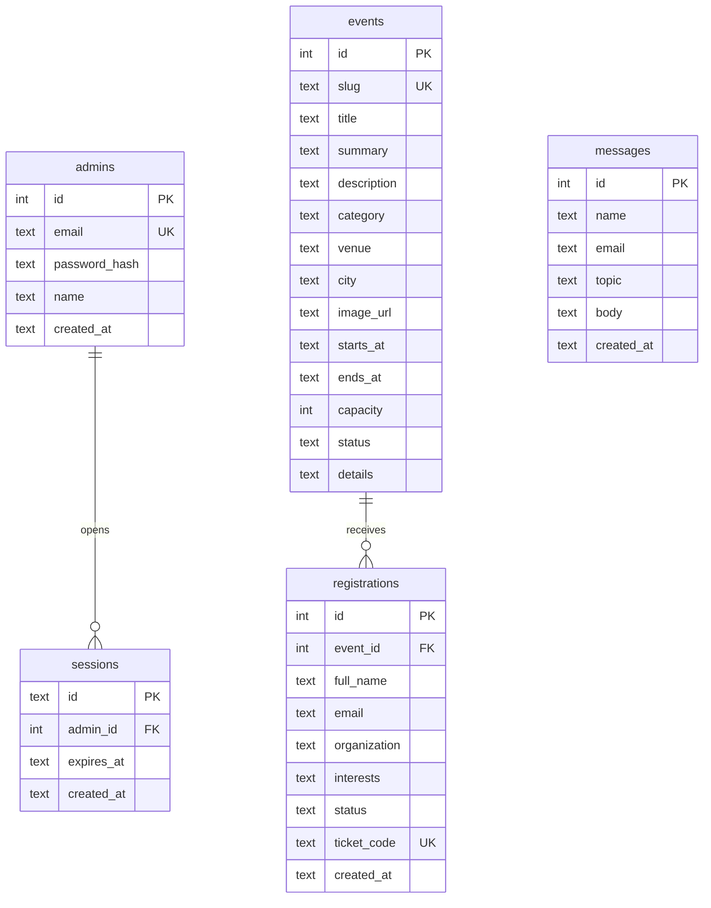

# Eventra

Eventra is a public event discovery and registration platform. Visitors browse events and register without an account. One administrator publishes the program, watches capacity, and manages attendees from the same SQLite database.

The people and events in the demo are fictional. Light and dark themes share the same pages; the theme toggle stores the choice in the browser and otherwise follows the system preference.

## Stack

- Frontend: React 19, Vite, JavaScript, React Router
- Styling: design tokens in `client/src/index.css` for light and dark themes
- Backend: Node.js, Express
- Database: SQLite through Node's built-in `node:sqlite`
- Auth: administrator sessions stored server-side, password hashed with bcrypt
- Tests: `node:test`

No paid services or paid APIs are used. Event photographs are downloaded from Unsplash and stored in `client/public/photos`, with the original SVG covers kept as a fallback if an image fails to load. Photographers retain copyright; the files are used under the [Unsplash License](https://unsplash.com/license).

## Project structure

```
client/                 React application
  public/photos/        Conference photographs used by the interface
  public/covers/        Fallback artwork
  src/pages/            Public and administrator screens
  src/components/       Shared interface pieces
server/
  src/schema.sql        Tables, indexes, foreign keys, capacity triggers
  src/services.js       Queries and registration rules
  src/app.js            HTTP API
  src/seed.js           Repeatable demo data
  test/api.test.js      Registration, capacity, auth, and persistence tests
```

## Installation

From the repository root:

```bash
npm install
npm run install:all
```

`npm install` installs the root dev tool that runs both processes. `npm run install:all` installs the existing client and the server. Do not recreate the Vite app.

Node.js 22.13 or newer is required because the server uses the built-in SQLite module. This project was developed on Node 24.

## Configuration

Copy the example environment file if you want to override the defaults:

```bash
copy .env.example .env
```

| Variable | Purpose |
| --- | --- |
| `PORT` | API port. Default `4000`. |
| `CLIENT_ORIGIN` | Browser origins allowed to call the API with cookies, comma-separated. Default `http://localhost:5173,http://localhost:5174`. |
| `DATABASE_PATH` | SQLite file relative to the `server/` directory. Default `data/eventra.sqlite`. |
| `ADMIN_NAME` | Display name used only when the administrator account is first created. |
| `ADMIN_EMAIL` | Administrator email. Default `organizer@eventra.demo`. |
| `ADMIN_PASSWORD` | Administrator password. Required when `NODE_ENV=production`. |

`.env.example` contains placeholders only. The server never prints the password, and the frontend does not contain it.

### Local demo administrator

If `ADMIN_PASSWORD` is unset and `NODE_ENV` is not `production`, the first startup creates:

- Email: `organizer@eventra.demo`
- Password: `eventra-demo-2026`

Change it by setting `ADMIN_PASSWORD` before the account is created. Starting the server again does not reset an existing password or delete registrations. `npm run db:reset` does delete the local database; it is not part of startup.

## Database commands

```bash
npm run db:init    # create tables if they do not exist
npm run db:seed    # create tables, organizer, and demo events only when empty
npm run db:reset   # delete the SQLite file, then seed again
```

`npm run dev` and `npm start` also create missing tables and seed only an empty database. They never delete an existing database.

## Run and build

```bash
npm run dev
```

- Public site: http://localhost:5173
- API: http://localhost:4000
- Administrator login: http://localhost:5173/admin/login
- Administrator dashboard: http://localhost:5173/admin

If port 5173 is already taken, Vite moves to the next free port, often 5174. Both origins are allowed by default. The Vite dev server proxies `/api` to the API, so the browser stays on one origin and the session cookie works.

Production-style run, after a build:

```bash
npm run build
npm start
```

Open http://localhost:4000. Express serves `client/dist` when that folder exists.

```bash
npm test
```

## Features

Visitors can browse events, search by title, description, topic, or location, filter by category, date, and city, sort, open an event, and register with full name, email, college or organization, and domain interests. Full events offer a waitlist. Cancelled and ended events stay understandable and refuse new registration. A confirmation page shows a QR ticket that encodes the ticket code, which the administrator can check in. The code can be downloaded as SVG or printed.

The administrator gets metrics from the database, event creation and editing, publish, unpublish, cancel, and archive actions, an attendee table with search, filters, status changes, pagination, CSV export, and ticket check-in. Cancelling a confirmed guest on a published event promotes the earliest waitlisted guest when a seat is free. There is no separate organizer role and no public account signup.

## Database schema



`UNIQUE (event_id, email)` on `registrations` is the duplicate-registration constraint. Confirmed and checked-in rows count toward capacity. Waitlisted and cancelled rows do not.

Foreign keys are enabled on every connection (`PRAGMA foreign_keys = ON`). The file uses WAL mode so a crash is less likely to tear a write. Startup runs `CREATE TABLE IF NOT EXISTS` and does not drop tables.

### events

| Column | Notes |
| --- | --- |
| `id` | Integer primary key |
| `slug` | Unique public identifier |
| `title`, `summary`, `description`, `category`, `venue`, `city`, `image_url` | Required text |
| `starts_at`, `ends_at`, `created_at`, `updated_at` | ISO-8601 timestamps |
| `capacity` | Integer from 1 to 20000 |
| `status` | `draft`, `published`, `cancelled`, or `archived` |

Indexes: `(status, starts_at)`, `category`, `city`, unique `slug`.

### registrations

| Column | Notes |
| --- | --- |
| `id` | Integer primary key |
| `event_id` | Foreign key to `events(id)` |
| `full_name`, `email`, `organization` | Required. Email is trimmed and lowercased before storage |
| `interests` | JSON array, checked with `json_valid` |
| `status` | `confirmed`, `waitlisted`, `cancelled`, or `checked_in` |
| `ticket_code` | Unique ticket code |
| `created_at`, `updated_at`, `checked_in_at` | Timestamps |

`UNIQUE (event_id, email)` stops the same normalized email from registering twice for one event. The same person can register for a different event.

Indexes: `(event_id, status)`, `email`, `created_at`, unique `ticket_code`.

### admins and sessions

Administrator passwords are bcrypt hashes. Session ids are random 32-byte tokens stored in `sessions`, sent only as an `HttpOnly`, `SameSite=Lax` cookie named `eventra_session`. The cookie is `Secure` when `NODE_ENV=production`.

### Capacity triggers

Confirmed and checked-in rows occupy a seat. Waitlisted and cancelled rows do not. Two triggers reject an insert or a status change that would make occupied seats greater than `events.capacity`:

- `enforce_capacity_insert`
- `enforce_capacity_update`

The application also checks capacity inside `BEGIN IMMEDIATE` before it inserts. The trigger is the database backstop if that check is ever skipped. SQLite serializes the immediate transaction, so concurrent requests cannot both take the last seat.

### Important queries

Seat counts joined onto an event:

```sql
SELECT e.*,
  COALESCE(SUM(CASE WHEN r.status IN ('confirmed', 'checked_in') THEN 1 ELSE 0 END), 0) AS confirmed_count,
  COALESCE(SUM(CASE WHEN r.status = 'waitlisted' THEN 1 ELSE 0 END), 0) AS waitlist_count
FROM events e
LEFT JOIN registrations r ON r.event_id = e.id
WHERE e.id = ?
GROUP BY e.id;
```

Duplicate registration, after the email has been lowercased:

```sql
SELECT id FROM registrations WHERE event_id = ? AND email = ?;
```

Oldest waitlisted guest promoted when a seat opens:

```sql
SELECT id FROM registrations
WHERE event_id = ? AND status = 'waitlisted'
ORDER BY created_at ASC, id ASC
LIMIT ?;
```

Search text is bound as a parameter and `%`, `_`, and `\` are escaped. Sort columns come from a fixed list, not from the request string.

Published fill rate avoids counting capacity once per registration by aggregating in a subquery:

```sql
SELECT COALESCE(SUM(capacity), 0) AS capacity, COALESCE(SUM(occupied), 0) AS occupied
FROM (
  SELECT e.capacity,
    COALESCE(SUM(CASE WHEN r.status IN ('confirmed', 'checked_in') THEN 1 ELSE 0 END), 0) AS occupied
  FROM events e
  LEFT JOIN registrations r ON r.event_id = e.id
  WHERE e.status = 'published'
  GROUP BY e.id
);
```

## API

Errors use one shape:

```json
{ "error": { "code": "DUPLICATE_REGISTRATION", "message": "This email is already registered for this event." } }
```

| Method | Path | Access | Result |
| --- | --- | --- | --- |
| GET | `/api/health` | Public | Service status |
| GET | `/api/highlights` | Public | Upcoming count, open seats, cities, confirmed guests |
| GET | `/api/events` | Public | Published or cancelled events. Query: `q`, `category`, `scope` (`upcoming`, `past`, `cancelled`, `all`), `from`, `to`, `sort` |
| GET | `/api/events/:id` | Public | One event by id or slug. Drafts and archived events return 404 |
| POST | `/api/events/:id/registrations` | Public | Create a registration |
| GET | `/api/tickets/:code` | Public | Ticket. Email is masked |
| GET | `/api/tickets/:code/download` | Public | SVG ticket |
| POST | `/api/admin/login` | Public | Sets the session cookie |
| POST | `/api/admin/logout` | Public | Clears the session |
| GET | `/api/admin/me` | Administrator | Current administrator |
| POST | `/api/admin/password` | Administrator | Change the password after checking the current one |
| GET | `/api/admin/metrics` | Administrator | Dashboard numbers |
| GET | `/api/admin/events` | Administrator | All statuses |
| POST | `/api/admin/events` | Administrator | Create an event |
| GET | `/api/admin/events/:id` | Administrator | Event, including drafts |
| PATCH | `/api/admin/events/:id` | Administrator | Update fields or status |
| GET | `/api/admin/registrations` | Administrator | Search, filter, paginate |
| PATCH | `/api/admin/registrations/:id` | Administrator | Change registration status |
| POST | `/api/admin/check-in` | Administrator | Check in a ticket code |
| GET | `/api/admin/registrations.csv` | Administrator | CSV export |

Registration body: `fullName`, `email`, `organization`, `interests`, and optional `waitlist`.

Status codes used by the registration rules:

- `201` registration created
- `400` invalid input or malformed JSON
- `401` administrator route without a session, or wrong password
- `404` missing event, registration, or ticket
- `409` duplicate email, event full, event unavailable, event ended, or capacity set below the current guest count
- `429` too many login or registration attempts
- `500` unexpected failure, without a stack trace in the response

## Tests

`server/test/api.test.js` covers successful registration, duplicate registration, validation failures, capacity limits, concurrent registration, database constraints, persistence after close and reopen, organizer authorization, attendee search, status updates, check-in, waitlist promotion, and CSV export.

## Troubleshooting

- **Port already in use.** Change `PORT`, or stop the other process.
- **The event list is empty.** Run `npm run db:seed`. If events already exist, seed leaves them alone.
- **Administrator sign-in fails.** Use the demo account above, or the values in `.env` if the account was created from those values. A signed-in administrator can change the password in Settings. `npm run db:reset` deletes the local database and registrations.
- **Production refuses to create an administrator.** Set `ADMIN_PASSWORD`. The local demo password is rejected when `NODE_ENV=production`.
- **Cookie is not kept.** Use `npm run dev` and open the Vite URL it prints (5173, or 5174 if 5173 is busy), or use `npm start` after a build and open port `4000`. Do not call the API from a different origin unless it is listed in `CLIENT_ORIGIN`.
- **Images.** Covers are served from `client/public/covers`, and the demo photographs from `client/public/photos`. A custom event can also use an `http` or `https` image URL.

## Submission checklist

- [ ] Push the repository to GitHub. Do not commit `.env`, `node_modules`, or `server/data/*.sqlite`.
- [ ] Confirm `.env.example` has placeholders, not a live password.
- [ ] Capture screenshots of the home calendar, an event with the registration form, a confirmation ticket, the full-event waitlist, the organizer overview, the attendee table, and check-in.
- [ ] Demo from a clean checkout with `npm install`, `npm run install:all`, `npm run dev`, then sign in with the local demo account.
- [ ] Run `npm test` and `npm run build` and keep the output with the submission if the course asks for it.

## Acceptance map

| Requirement | Implementation | Verification |
| --- | --- | --- |
| React + Vite client, React Router preserved | `client/`, `client/src/App.jsx` | Production build |
| Express API and SQLite | `server/src/app.js`, `server/src/db.js`, `server/src/schema.sql` | Server startup and tests |
| Events, search, filters, sorting, detail | `listEvents`, `EventsPage.jsx`, `EventDetailPage.jsx` | Browser calendar and detail |
| Registration fields and validation | `server/src/validate.js`, `client/src/validation.js` | Automated invalid-input test and the form |
| Normalized email and HTTP 409 duplicates | unique `(event_id, email)` | Automated duplicate test |
| Capacity, transactions, and triggers | `withTransaction`, capacity triggers | Automated capacity, concurrency, and trigger tests |
| Persistence across restart | SQLite file, `CREATE IF NOT EXISTS` | Automated reopen test |
| Organizer auth and hashed passwords | `server/src/auth.js` | Automated 401 and login tests |
| Attendee search, status, check-in, CSV | Admin routes and attendee pages | Automated tests and browser |
| Metrics and charts from database rows | `getMetrics`, `Charts.jsx` | Overview page |
| Waitlist, QR ticket, confirmation | Registration status, ticket routes | Automated promotion test and ticket page |
