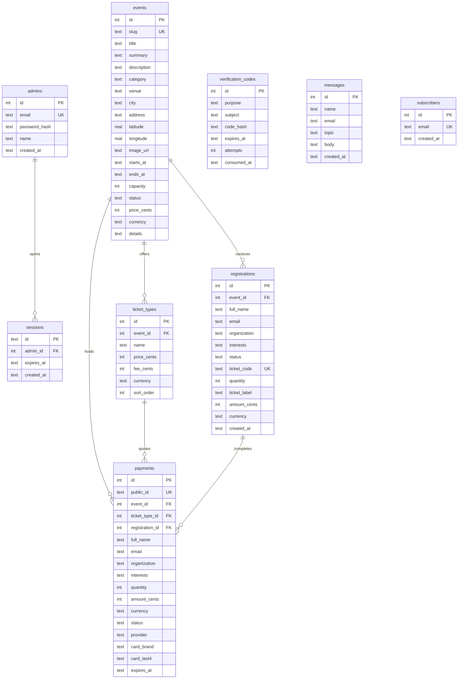

# Eventra

Eventra is an event registration platform for the CodeNova Full Stack Development Internship, Task 3. Visitors can browse a public program, register for an event, and keep a ticket. One administrator manages the same records from a dashboard.

The people, colleges, and events in the seed data are fictional. Payments in the local application are simulated. Eventra does not charge a card and does not store a full card number or security code.

## Project purpose and overview

The project demonstrates a complete registration loop:

1. A public page shows each event's title, schedule, description, and remaining capacity.
2. A guest registers with a name, email address, college or organization, and domain interests.
3. The API rejects a second registration for the same event and email with HTTP 409.
4. The administrator sees the attendees, can search them, and can read each registration status.
5. Counts come from the SQLite database, so they survive a browser refresh and a server restart.

Around that assignment, Eventra also includes event detail pages, category and date filters, ticket QR codes, My Tickets email verification, a simulated paid checkout, light and dark themes, and a responsive layout.

## Main features

- Public event list with search, category, city, date, price, and sort controls.
- Event detail pages with the schedule stored for that event, venue, and a Google Maps link.
- Registration for name, email, college or organization, and domain interests.
- Backend duplicate protection with `UNIQUE (event_id, email)` and HTTP 409.
- Seat counts calculated from registration rows, including quantity.
- Waitlist when a free event is full, and promotion of the oldest waitlisted guest when a confirmed seat is cancelled.
- Ticket page with a QR code, SVG download, and share or copy actions.
- My Tickets flow that emails a one-time code through Resend and then lists that address's tickets.
- Simulated checkout for priced tickets. The browser validates the card locally and sends only the brand and last four digits.
- Administrator login, metrics, event editing, attendee search, status badges, check-in, and CSV export.
- Light and dark themes, stored in the browser, otherwise following the system preference.
- Responsive public navigation.

## Technology stack

- Frontend: React 19, Vite, JavaScript, React Router 7
- Styling: CSS design tokens in `client/src/index.css`
- Backend: Node.js, Express 4
- Database: SQLite through Node's built-in `node:sqlite`
- Passwords: bcrypt hashes in `admins.password_hash`
- Mail: the Resend SDK in `server/src/mail.js`
- QR codes: the `qrcode` package, rendered on the server
- Tests: `node:test`

Node.js 22.13 or newer is required because the server uses the built-in SQLite module. This project was developed on Node 24.

No paid hosting, paid database, or paid UI library is required. Resend is an external email service. A local demo can browse, register for free events, and run the automated tests without it. Verification emails are sent only when `RESEND_API_KEY` and `EMAIL_FROM` are set and Resend accepts the message. Razorpay code exists in the server and stays inactive unless both Razorpay key variables are set. The local internship setup does not set them, and the visitor-facing paid path is the simulated checkout.

Event photographs live in `client/public/photos`. SVG covers in `client/public/covers` are the fallback if a photograph fails to load. The photographs were downloaded from Unsplash. Photographers retain copyright. The files are used under the [Unsplash License](https://unsplash.com/license).

## Architecture overview

The browser talks to the Vite development server. Vite proxies `/api` to the Express process, so the session cookie stays on one origin. Express reads and writes one SQLite file. On startup the server creates missing tables, creates the administrator account if it does not exist, and inserts the demo calendar only when the events table is empty.

```text
Browser (React)
    |
    |  /api proxied in development
    v
Express (server/src/app.js)
    |
    +-- auth.js          administrator session cookie
    +-- services.js      events, registration, attendees, tickets
    +-- payments.js      simulated checkout and optional Razorpay path
    +-- access.js        My Tickets verification codes
    +-- mail.js          Resend delivery
    v
SQLite (server/data/eventra.sqlite by default)
```

In a production-style local run, `npm run build` writes `client/dist`, and `npm start` serves that folder from Express on the API port.

## Project folder structure

```text
client/                     React application
  public/covers/            Fallback SVG artwork
  public/photos/            Event photographs
  src/pages/                Public pages and administrator screens
  src/components/           Shared layout, maps, sharing, charts
  src/api.js                Fetch wrapper used by every page
  src/validation.js         Registration form checks
server/
  src/schema.sql            Tables, indexes, foreign keys, capacity triggers
  src/db.js                 SQLite connection and column migrations
  src/seed.js               Demo administrator, events, and fictional attendees
  src/catalog.js            Addresses, schedules, and ticket prices
  src/app.js                HTTP API
  src/services.js           Registration rules and attendee queries
  src/payments.js           Simulated payment and verification
  src/access.js             My Tickets verification
  src/mail.js               Resend email
  src/auth.js               Password hashing and sessions
  test/api.test.js          API and persistence tests
.env.example                Placeholder environment variables
```

## Database design

Eventra uses one SQLite file. `server/src/db.js` enables foreign keys and WAL mode for file databases. Startup runs `CREATE TABLE IF NOT EXISTS` from `server/src/schema.sql` and then adds any missing columns. It does not drop tables or delete registrations.

Confirmed and checked-in registrations occupy seats. The occupied count is the sum of `quantity`, not merely the number of rows. Waitlisted and cancelled rows do not occupy a seat. Pending payments hold seats until they expire. Two triggers, `enforce_capacity_insert` and `enforce_capacity_update`, abort a write that would pass `events.capacity`. The application also checks capacity inside `BEGIN IMMEDIATE` before it inserts.

`UNIQUE (event_id, email)` is the duplicate-registration constraint. Email is trimmed and lowercased before it is stored. The same address may register for a different event.

`card_brand` and `card_last4` are added by `migrate()` because older databases predate those columns. They are the only card fields stored. The full card number, expiry, and security code are not columns.

## Database tables and relationships

- `events` is the program. Public pages read published and cancelled rows. Draft and archived rows stay on the administrator side.
- `ticket_types` belongs to an event. Seeded prices exist for Atlas Founder Forum, Lumen, and Kiln. Other demo events stay free.
- `registrations` belongs to an event. One email can appear once per event. The ticket code is unique across the table.
- `payments` belongs to an event and, when the checkout finishes, points at the registration it created. A simulated row uses provider `development`. The API reports that provider as `simulation`.
- `admins` has one local administrator. `sessions` stores the random session id sent as the `eventra_session` cookie.
- `verification_codes` stores a hash of a one-time code, not the code itself. The subject is an email address for My Tickets or a payment id for checkout. It is not a foreign key.
- `messages` stores contact-form notes for the administrator.
- `subscribers` stores newsletter addresses from the home page.

Seed data is fictional. Names come from `PEOPLE` in `server/src/seed.js`. Addresses look like `given.family.event-slug@campus.example`. Ticket codes look like `EVSEED0001`. Dates are generated relative to the day the database is seeded, so the public list stays in the future after a fresh seed. `applyCatalog()` then fills addresses, map coordinates, detail copy, and the priced ticket types when those fields are still empty.

## Mermaid ER diagram



`registrations` also has the composite unique key `(event_id, email)`. `ticket_types` has `(event_id, name)`. `payments.ticket_type_id` and `payments.registration_id` are nullable. `messages`, `subscribers`, and `verification_codes` do not reference other tables.

## Database initialization instructions

From the repository root:

```bash
npm run db:init
```

That creates the SQLite file and tables if they do not exist. It does not insert events.

```bash
npm run db:seed
```

That creates tables, the administrator, and the demo calendar only when the events table is empty. If events already exist, the seed leaves them in place.

```bash
npm run db:reset
```

That deletes the local SQLite file and seeds it again. It removes local registrations. It is not part of normal startup.

`npm run dev` and `npm start` also create missing tables and seed an empty database. They do not delete an existing database.

The default file is `server/data/eventra.sqlite`. `DATABASE_PATH` is resolved relative to the `server/` directory unless it is absolute or `:memory:`.

## Seed data explanation

`npm run db:seed` calls `initializeDatabase()` in `server/src/seed.js`:

1. `migrate()` applies `schema.sql` and any missing columns.
2. `ensureAdmin()` inserts the administrator only when that email is absent. It does not reset an existing password.
3. `seedEventsIfEmpty()` inserts the fictional calendar and its sample attendees only when `events` has zero rows.
4. `applyCatalog()` adds venue coordinates, detail schedules, photographs, and priced ticket types without wiping an edited event.

Sample attendees are there so the administrator table is not empty on a fresh checkout. They are not real people.

## Frontend installation and setup

Prerequisites: Node.js 22.13 or newer, and npm.

From the repository root:

```bash
npm install
npm run install:all
```

`npm install` installs the root tool that runs both processes. `npm run install:all` installs `client/` and `server/`. Do not recreate the Vite application.

The client has no separate environment file. It calls relative `/api` paths. The Vite config proxies those paths to `http://localhost:4000`.

## Backend installation and setup

The backend dependencies are installed by `npm run install:all`. Configuration is read from `server/.env` and then from the repository root `.env`. A value already set in the environment, or already read from `server/.env`, is left unchanged.

Copy the example file before adding real mail settings:

```bash
copy .env.example .env
```

On macOS or Linux, use `cp .env.example .env`. You may instead create `server/.env` with the same keys. Do not commit either file.

## Environment variable configuration

| Variable | Purpose |
| --- | --- |
| `PORT` | API port. Default `4000`. |
| `CLIENT_ORIGIN` | Comma-separated browser origins allowed to call the API with cookies. Default `http://localhost:5173,http://localhost:5174`. |
| `DATABASE_PATH` | SQLite file relative to `server/`. Default `data/eventra.sqlite`. |
| `ADMIN_NAME` | Display name used only when the administrator row is first created. Default `Avery Quinn`. |
| `ADMIN_EMAIL` | Administrator email. Default `organizer@eventra.demo`. |
| `ADMIN_PASSWORD` | Password used only when the administrator row is first created. Required when `NODE_ENV=production`. |
| `RESEND_API_KEY` | Resend API key. Required to send a verification code. |
| `EMAIL_FROM` | Sender address Resend will accept. Required together with the API key. |
| `OTP_PEPPER` | Secret mixed into the hash of each verification code. |
| `RAZORPAY_KEY_ID` | Optional. Unused while unset. |
| `RAZORPAY_KEY_SECRET` | Optional. Unused while unset. |
| `RAZORPAY_WEBHOOK_SECRET` | Optional. Required only if the Razorpay webhook route is used. |

`.env.example` contains placeholders only.

If `ADMIN_PASSWORD` is unset and `NODE_ENV` is not `production`, the first startup creates:

- Email: `organizer@eventra.demo`
- Password: `eventra-demo-2026`

That password is a local demo value. It is rejected when `NODE_ENV=production` and `ADMIN_PASSWORD` is missing. Change it from Administrator Settings after signing in, or set `ADMIN_PASSWORD` before the account is created. Starting the server again does not reset an existing password.

If `OTP_PEPPER` is unset, the server falls back to a development string in source. Set a long random pepper before sharing a deployment. Codes are stored as HMAC hashes. The plaintext code is not stored and is not returned by the API.

## Exact commands to run both services

Development, with both processes:

```bash
npm run dev
```

- Public site: http://localhost:5173
- API: http://localhost:4000
- Administrator login: http://localhost:5173/admin/login
- Attendee dashboard: http://localhost:5173/admin/attendees

If port 5173 is taken, Vite moves to the next free port, often 5174. Both origins are allowed by default.

Either process alone:

```bash
npm run dev:server
npm run dev:client
```

Production-style local run:

```bash
npm run build
npm start
```

Open http://localhost:4000. Express serves `client/dist` when that folder exists.

Tests:

```bash
npm test
```

Client lint:

```bash
npm run lint --prefix client
```

## API documentation

Errors use one shape:

```json
{ "error": { "code": "DUPLICATE_REGISTRATION", "message": "This email is already registered for this event." } }
```

Validation errors may also include `error.fields`.

| Method | Path | Access | Result |
| --- | --- | --- | --- |
| GET | `/api/health` | Public | `{ "ok": true, "service": "eventra" }` |
| GET | `/api/highlights` | Public | Upcoming count, open seats, cities, confirmed guests |
| GET | `/api/events` | Public | Published or cancelled events. Query: `q`, `category`, `city`, `scope` (`upcoming`, `past`, `cancelled`, `all`), `from`, `to`, `price` (`free`, `paid`), `sort` (`soonest`, `latest`, `title`, `popular`, `price`, `price_desc`), `limit`, `offset` |
| GET | `/api/events/:id` | Public | One event by numeric id or slug, including `capacity`, `confirmedCount`, and `seatsRemaining`. Drafts and archived events return 404 |
| POST | `/api/events/:id/registrations` | Public | Create a free registration. Body: `fullName`, `email`, `organization`, `interests`, optional `quantity`, `ticketTypeId`, `waitlist` |
| POST | `/api/events/:id/checkout` | Public | Free events return the registration. Priced events return a pending payment |
| POST | `/api/contact` | Public | Save a contact message |
| POST | `/api/subscribe` | Public | Save a newsletter address once |
| GET | `/api/tickets/:code` | Public | Ticket. Email is masked. Includes a QR data URL |
| GET | `/api/tickets/:code/status` | Public | Status and validity without the full ticket |
| GET | `/api/tickets/:code/download` | Public | SVG ticket download |
| POST | `/api/tickets/otp` | Public | Email a My Tickets code. Body: `{ "email": "..." }` |
| POST | `/api/tickets/otp/verify` | Public | Exchange the code for a short-lived access token and the tickets |
| POST | `/api/tickets/list` | Public | List tickets again with `{ "accessToken": "..." }` |
| GET | `/api/payments/:publicId` | Public | Payment summary. No full card number |
| POST | `/api/payments/:publicId/card` | Public | Store brand and last four digits, then email a code |
| POST | `/api/payments/:publicId/otp` | Public | Send another payment code |
| POST | `/api/payments/:publicId/otp/verify` | Public | Confirm a simulated payment and create the registration |
| POST | `/api/payments/:publicId/simulate` | Development only | Mark a simulated payment paid, failed, or cancelled. Returns 403 when `NODE_ENV=production` |
| POST | `/api/payments/:publicId/cancel` | Public | Cancel a pending checkout |
| POST | `/api/payments/razorpay/verify` | Public | Verify a Razorpay signature. Unused unless Razorpay is configured |
| POST | `/api/webhooks/razorpay` | Razorpay | Webhook. Unused unless `RAZORPAY_WEBHOOK_SECRET` is set |
| POST | `/api/admin/login` | Public | Sets the `eventra_session` cookie |
| POST | `/api/admin/logout` | Public | Clears the session |
| GET | `/api/admin/me` | Administrator | Current administrator |
| POST | `/api/admin/password` | Administrator | Change password after checking the current one |
| GET | `/api/admin/metrics` | Administrator | Dashboard counts from the database |
| GET | `/api/admin/messages` | Administrator | Latest contact messages |
| GET | `/api/admin/events` | Administrator | Events in every status |
| POST | `/api/admin/events` | Administrator | Create an event |
| GET | `/api/admin/events/:id` | Administrator | One event, including drafts |
| PATCH | `/api/admin/events/:id` | Administrator | Update fields or status |
| GET | `/api/admin/registrations` | Administrator | Search, filter, and paginate attendees |
| PATCH | `/api/admin/registrations/:id` | Administrator | Change registration status |
| POST | `/api/admin/check-in` | Administrator | Check in a ticket code |
| GET | `/api/admin/registrations.csv` | Administrator | CSV export |

Registration status codes:

- `201` registration created
- `200` checkout or payment step accepted
- `400` invalid input or malformed JSON
- `401` administrator route without a session, or wrong password
- `402` direct registration attempted for a priced ticket
- `403` origin not allowed, or payment simulation in production
- `404` missing event, registration, ticket, or payment
- `409` duplicate email, event full, event unavailable, event ended, or a closed payment
- `429` too many attempts
- `500` unexpected failure, without a stack trace in the response
- `503` verification email could not be accepted by Resend

The session cookie is `HttpOnly` and `SameSite=Lax`. It is marked `Secure` when `NODE_ENV=production`.

## Registration workflow

1. The guest opens an event at `/events/:slug` and chooses Register.
2. The form collects ticket type and quantity, then full name, email, college or organization, and one or more domain interests.
3. The review step asks the guest to confirm the details.
4. The browser sends `POST /api/events/:id/checkout`.
5. For a free ticket, the server inserts a `confirmed` registration, or `waitlisted` when the event is full and the guest asked to wait. The response is HTTP 201 with `registration.ticketCode` and a QR data URL. The browser opens `/confirmation/:code`.
6. For a priced ticket, the server inserts a pending payment and the browser opens `/pay/:publicId`. No registration row exists until the simulated payment is verified.
7. After a refresh, `GET /api/events/:id` reads `confirmedCount` and `seatsRemaining` from the database.

The client checks the form first. The server repeats those checks in `server/src/validate.js` and is the authority.

## Duplicate registration prevention and HTTP 409 handling

Prevention does not depend on the form.

- The email is normalized to lowercase before the lookup and the insert.
- `registerForEvent()` and `startCheckout()` both look for an existing `(event_id, email)` row inside a transaction.
- `UNIQUE (event_id, email)` remains if that lookup is ever skipped. A unique-constraint failure is mapped to the same HTTP 409.
- The response body is:

```json
{
  "error": {
    "code": "DUPLICATE_REGISTRATION",
    "message": "This email is already registered for this event.",
    "fields": { "email": "This email is already registered for this event." }
  }
}
```

`client/src/api.js` puts `error.message` on the thrown error and copies `error.fields`. The review step on the registration page renders that message. A different event can still accept the same email.

## Admin dashboard functionality

Sign in at `/admin/login`. The overview at `/admin` reads `/api/admin/metrics`.

The attendee page at `/admin/attendees` lists registrations from `/api/admin/registrations`. The table shows name, email, college or organization, domain interests, event, registration time, and a status badge. Status values are Confirmed, Waitlist, Checked in, and Cancelled. Search matches name, email, organization, ticket code, and event title. The query is bound as a parameter. Event and status filters and CSV export use the same server filters.

Status changes go through `PATCH /api/admin/registrations/:id`. Cancelling a confirmed guest on a published event promotes the earliest waitlisted guest when a seat is free. Check-in is also available at `/admin/check-in`.

There is no public account signup and no second administrator role.

## Ticket generation and retrieval

A ticket code is generated when the registration row is inserted. It starts with `EV` and is unique. The confirmation page and `/tickets/:code` load `GET /api/tickets/:code`. The public response masks the email and includes a QR image of the ticket code. `GET /api/tickets/:code/download` returns an SVG attachment.

My Tickets at `/tickets` asks for the registration email.

1. `POST /api/tickets/otp` generates a six-digit code, emails it, and stores only the hash.
2. `POST /api/tickets/otp/verify` checks the hash, expires after five minutes, and allows five attempts.
3. A short-lived access token lists that email's tickets through `POST /api/tickets/list`.

The code is not included in the JSON response. Resend must accept the email before the API reports that a code was sent.

The ticket page can use the browser share sheet, and event pages include copy, WhatsApp, email, and LinkedIn share actions. Those actions only share the page URL.

## Simulated payment workflow

Priced demo events are Atlas Founder Forum, Lumen: Jazz After Code, and Kiln Robotics Showcase. Every other seeded event is free and never opens checkout.

When Razorpay variables are unset, `startCheckout()` stores the provider as `development`. The payment view tells the client `provider: "simulation"`. The payment page then:

1. Checks the card number, expiry, and security code in the browser.
2. Sends `cardLast4`, `cardBrand`, and `cardholderName` only.
3. Asks Resend to email a six-digit code to the registration address.
4. Confirms the registration only after `POST /api/payments/:publicId/otp/verify` accepts that code.

The full card number and security code are cleared from component state after the request. They are not database columns. The stored payment can show the brand and last four digits.

This is not a charge. No bank or card network is contacted on the simulated path. `POST /api/payments/:publicId/simulate` can mark a development payment paid or failed, and the automated tests use it. The payment page does not call that route. It uses the emailed code. Simulation returns HTTP 403 when `NODE_ENV=production`.

If both `RAZORPAY_KEY_ID` and `RAZORPAY_KEY_SECRET` are present, paid checkout uses Razorpay instead of the simulation. Leave them unset for this project. Do not enter a real card even on the simulated form.

## Email OTP configuration and limitations

Set both of these in an untracked env file:

```env
RESEND_API_KEY=your_resend_api_key_here
EMAIL_FROM=Eventra <your_verified_sender@example.com>
```

`server/src/mail.js` sends with the Resend SDK. The application reports success only when Resend returns a message id. If either variable is missing, or Resend rejects the message, the API returns HTTP 503 with `DELIVERY_UNAVAILABLE` and the message "We could not send a verification code. Please try again." The server log records the failure status with API-key-shaped text and six-digit codes redacted. It does not record the code.

Codes expire after five minutes. A new code can be requested once a minute, and at most five times an hour for the same subject. Failed guesses stop after five attempts.

If `EMAIL_FROM` is on `resend.dev`, Resend treats it as a testing sender and delivers only to the mailbox that owns the Resend account. Mail to any other registrant does not arrive until a domain you control is verified and used as the sender. This repository does not claim that every registrant will receive mail. The automated tests do not call Resend. They read an in-memory inbox when `NODE_ENV=test`.

## Screenshots

Interface screenshots are not in this repository yet. The photograph files in `client/public/photos` are event artwork, not assignment screenshots. Capture the views below and add them in a later commit. Suggested paths:

| File to add | What to capture |
| --- | --- |
| `docs/screenshots/01-public-events.png` | Public events page showing title, schedule, description or summary, and available capacity |
| `docs/screenshots/02-event-registration.png` | Event details and the registration form, including name, email, college or organization, and domain interests |
| `docs/screenshots/03-registration-confirmation.png` | Successful registration or the ticket confirmation page |
| `docs/screenshots/04-my-tickets.png` | My Tickets page, either the email step or the ticket list after verification |
| `docs/screenshots/05-admin-attendees.png` | Administrator attendee table with search and status badges |

Optional, not required to close the screenshot gap: a duplicate-registration error, the simulated payment page, and the same public page in dark mode and at a narrow width.

Until those files exist, this section is the pending-screenshots list. Do not treat the paths above as files that are already committed.

## Testing instructions

Automated suite, from the repository root:

```bash
npm test
```

`server/test/api.test.js` uses a temporary or in-memory database. It does not read or write `server/data/eventra.sqlite`. It covers registration, duplicate emails, validation, capacity, concurrent registration, database constraints, persistence after close and reopen, administrator authorization, attendee search, status updates, check-in, waitlist promotion, CSV export, simulated payment, ticket verification, and the case where Resend is not configured.

Client production build:

```bash
npm run build
```

Manual checks on a normal development database:

1. Run `npm run dev`.
2. Open http://localhost:5173/events and confirm title, schedule, description, and seats remaining.
3. Register for a free event with a new `campus.example` address.
4. Submit the same email again and confirm the duplicate message.
5. Refresh the event page and confirm the seat count changed by the ticket quantity.
6. Stop and start the server, then confirm the registration is still there.
7. Sign in at `/admin/login` and search the attendee table.
8. Open `/tickets/:code` for the new ticket code.

`npm run db:reset` deletes the local database. Use it only when you intend to discard local registrations.

## Known limitations

- Paid checkout is a simulation unless Razorpay keys are deliberately configured. This submission expects the simulation. No real payment is processed.
- Verification email works only for recipients Resend accepts for the configured sender. A sender on `resend.dev` is a testing sender and does not deliver to every address.
- The development OTP pepper in source is used when `OTP_PEPPER` is empty. Set a private pepper before any shared deployment.
- The demo administrator password is public in this README and in `server/src/seed.js`. It is for local review only.
- Google Maps links and the embedded map use public Google Maps URLs. There is no Google API key.
- Share actions open the browser share sheet or a public share URL. They do not send mail through Eventra.
- `npm run lint --prefix client` currently reports three `react-refresh/only-export-components` errors in `client/src/components/VenueMap.jsx` and `client/src/theme.jsx`. The production build still completes. Those files export helpers next to components.
- The local SQLite file can contain registrations created on your machine. It is gitignored and is not part of the public project. A new checkout builds its own demo data with `npm run db:seed`.
- Assignment screenshots are still to be captured. See the Screenshots section.

## Troubleshooting

- **Port already in use.** Change `PORT`, or stop the other process.
- **The event list is empty.** Run `npm run db:seed`. If events already exist, seed leaves them alone.
- **Administrator sign-in fails.** Use the demo account above, or the `ADMIN_EMAIL` and `ADMIN_PASSWORD` that were set when the account was first created. A signed-in administrator can change the password in Settings.
- **Verification email fails.** Confirm `RESEND_API_KEY` and `EMAIL_FROM`, and confirm Resend allows that sender and recipient. The API will not pretend the code was sent.
- **Cookie is not kept.** Use `npm run dev` and the Vite URL it prints, or use `npm start` after a build and open port 4000. Call the API from an origin listed in `CLIENT_ORIGIN`.
- **Images.** Photographs are served from `client/public/photos`. If one fails, the card falls back to `client/public/covers/custom.svg`.
